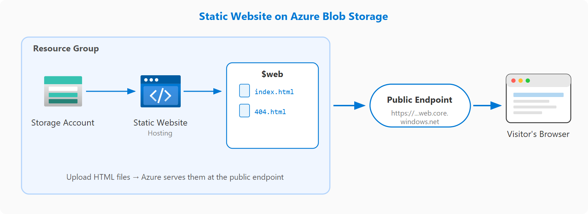

# Project 01: Deploy a Static Website with Azure Blob Storage

Part of [Azure Guided Projects](../README.md).

## Objective

Host a public landing page using only Azure Blob Storage, with no virtual machines or web servers. Upload the content, verify it is live, push an update and confirm the change.

The project is built twice: first through the **Azure portal**, then as **Terraform** code.

## Scenario

A marketing team needs to publish a product landing page quickly, without provisioning virtual machines or web servers. They want to upload content, verify it is live, push an update and confirm the change.


## Architecture

```text
Resource group (rg-gp-static-website)
└── Storage account (Standard, LRS)
    └── $web container  ← created by the static website feature
        ├── index.html  (landing page)
        └── 404.html    (custom error page)
```

Visitors reach the files through the storage account's **primary endpoint URL**, which Azure generates when static website hosting is enabled.

## Exercises

### 01. Create storage account and enable hosting
- Task 1: Prepare the environment
- Task 2: Create the storage account
- Task 3: Enable static website hosting

### 02. Upload and verify site content
- Task 1: Create the HTML file locally
- Task 2: Upload the file to the `$web` container
- Task 3: Create and upload a custom error page
- Task 4: Verify the live site and error page

### 03. Update the site content
- Task 1: Create the updated HTML file
- Task 2: Upload the updated file
- Task 3: Verify the updated site
- Task 4: Review blob properties and access tier

### 04. Validate success
Checks every success criterion listed below.

### 05. Clean up resources
- Task 1: Delete the resource group
- Task 2: Verify cleanup


## Progress

| # | Exercise | Portal | Terraform |
|---|----------|:------:|:---------:|
| 01 | [Create storage account and enable hosting](./portal/01-create-storage-and-hosting.md) | Done | Pending |
| 02 | [Upload and verify site content](./portal/02-upload-and-verify-content.md) | Done | Pending |
| 03 | [Update the site content](./portal/03-update-site-content.md) | Done | Pending |
| 04 | [Validate success](./portal/04-validate-success.md) | Done | Pending |
| 05 | Clean up resources | Pending | Pending |

## Success criteria

- [ ] Storage account is created with static website hosting **Enabled**, and a **Primary endpoint URL** is displayed
- [ ] The `$web` container contains both `index.html` and `404.html`
- [ ] The landing page displays **Version 1 - Landing Page** when first published
- [ ] Browsing to a nonexistent path shows the custom **404 - Page Not Found** page
- [ ] The updated **Version 2 - Landing Page** content is visible on the live site
- [ ] Both blobs show content type `text/html` and access tier `Hot`

## Folder contents

| Folder | Purpose |
|--------|---------|
| `portal/` | One walkthrough per exercise, with screenshots, from the portal run |
| `terraform/` | Terraform configuration that recreates the same infrastructure |
| `site/` | HTML files used by both approaches |

## Prerequisites

- An Azure subscription (this project uses an Azure for Students subscription)
- [Azure CLI](https://learn.microsoft.com/en-us/cli/azure/) and [Terraform](https://developer.hashicorp.com/terraform) installed
- Signed in with `az login`

## Lessons learned

_To be completed at the end of the project._

## Cost note

All resources are deleted at the end of the project to avoid charges.