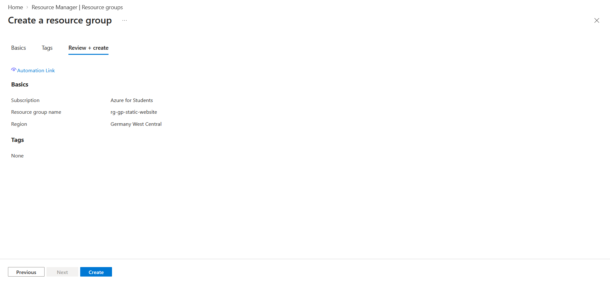
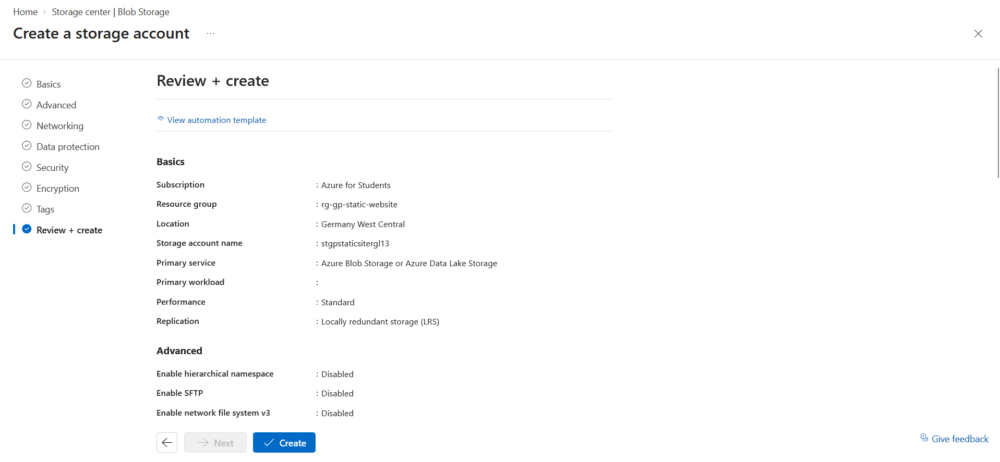
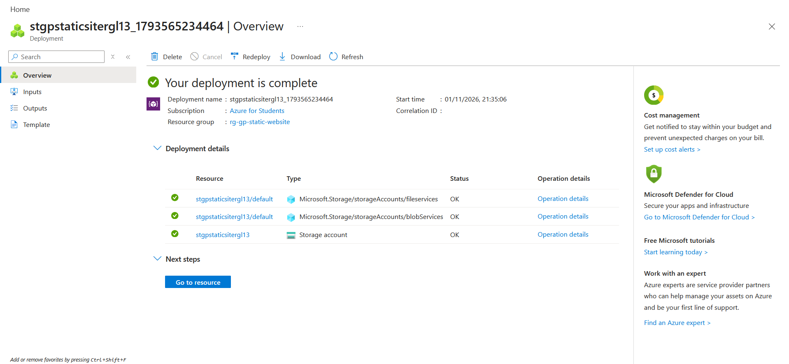
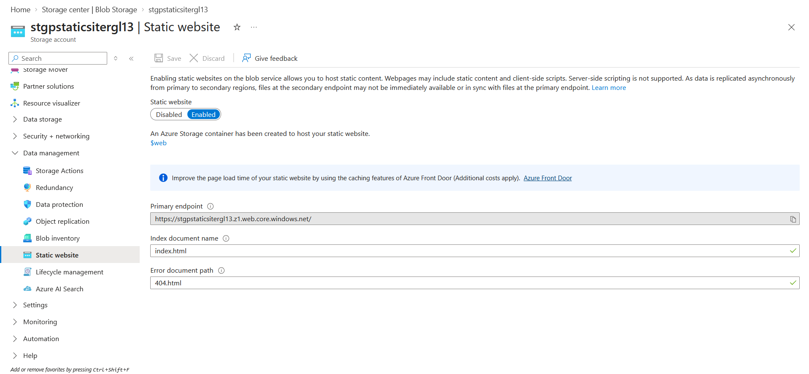

# Exercise 01: Create Storage Account and Enable Hosting

**Outcome:** a storage account with static website hosting enabled and a public endpoint ready to serve content, even though no files are uploaded yet.

| Item | Value |
|------|-------|
| Resource group | `rg-gp-static-website` |
| Region | Germany West Central (`germanywestcentral`) |
| Storage account | `stgpstaticsitergl13` |
| Performance / redundancy | Standard / LRS |
| Primary endpoint | `https://stgpstaticsitergl13.z1.web.core.windows.net/` |

## Task 1: Prepare the environment

Create a resource group to hold every resource of the project, so cleanup is a single deletion at the end:

1. Signed in to the Azure portal with the student account.
2. Searched for **Resource groups** and selected **+ Create**.
3. Named the group `rg-gp-static-website` and selected **Germany West Central** as the region.
4. Ran **Review + create**, got "Validation passed", then selected **Create**.



**Region choice:** the Azure for Students subscription restricts which regions can be used, so the region was picked from the allowed list rather than by proximity. This region is reused for every resource in the project.

**Verification:** the group appears in the portal, and the CLI confirms it:

```powershell
az group show --name rg-gp-static-website --query "{name:name, location:location, state:properties.provisioningState}" -o table
```

```text
Name                  Location            State
--------------------  ------------------  ---------
rg-gp-static-website  germanywestcentral  Succeeded
```

**Why a resource group?** It groups every resource of the project, so the cleanup exercise only needs to delete this one object.


## Task 2: Create the storage account

Create a general-purpose storage account:

| Setting | Choice | Reason |
|---------|--------|--------|
| Performance | Standard | Cheapest option, enough for a static page |
| Redundancy | LRS | Three copies in one datacenter, lowest cost |
| Name | `stgpstaticsitergl13` | Must be globally unique, 3-24 lowercase letters and digits |

1. Searched for **Storage accounts** and selected **+ Create**.
2. On the **Basics** tab, selected the existing resource group `rg-gp-static-website`.
3. Named the account `stgpstaticsitergl13`: the exercise's `stgpstaticsite` prefix, plus initials and a number.
4. Selected **Germany West Central**, the same region as the resource group.
5. Chose **Standard** performance and **Locally-redundant storage (LRS)** redundancy.
6. Left every other tab at its default, then ran **Review + create** and **Create**.
7. When the deployment finished, selected **Go to resource**.




**Why these settings?**

- **Standard** uses disk-based storage and is the cheapest tier. Premium (SSD) is meant for very low-latency workloads, which a landing page doesn't need.
- **LRS** keeps three copies of the data inside one datacenter. It is the lowest-cost option and enough for practice. A production site would typically choose ZRS or GRS for resilience.
- The account name becomes part of the public website URL, which is why it must be globally unique and limited to lowercase letters and digits.

**Verification:** the CLI confirms the account matches what the portal showed:

```powershell
az storage account show --name stgpstaticsitergl13 --resource-group rg-gp-static-website --query "{name:name, location:location, sku:sku.name, kind:kind, state:provisioningState}" -o table
```

```text
Name                 Location            Sku           Kind       State
-------------------  ------------------  ------------  ---------  ---------
stgpstaticsitergl13  germanywestcentral  Standard_LRS  StorageV2  Succeeded
```


## Task 3: Enable static website hosting

Enable the static website feature, which creates the `$web` container, and set: Index document `index.html`, served at the root URL, and  Error document `404.html`, served for paths that don't exist:

1. Opened the storage account and selected **Static website** under **Data management**.
2. Set the toggle to **Enabled**.
3. Entered `index.html` as the index document and `404.html` as the error document path.
4. Selected **Save**.
5. Copied the **Primary endpoint** shown after saving: `https://stgpstaticsitergl13.z1.web.core.windows.net/`



**What changed:**

- A container named `$web` was created automatically. Only files stored there are served.
- The account gained a public web endpoint, separate from the normal blob endpoint.
- The site returns an error until `index.html` is uploaded in Exercise 02. That is expected.

**Verification:** the CLI confirms the feature is on and the endpoint matches the portal:

```powershell
az storage blob service-properties show --account-name stgpstaticsitergl13 --auth-mode login --query "staticWebsite" -o json
az storage account show --name stgpstaticsitergl13 --resource-group rg-gp-static-website --query "primaryEndpoints.web" -o tsv
```

```json
{
  "defaultIndexDocumentPath": null,
  "enabled": true,
  "errorDocument_404Path": "404.html",
  "indexDocument": "index.html"
}
```

```text
https://stgpstaticsitergl13.z1.web.core.windows.net/
```

## Validation

- [x] Static website shows **Enabled**
- [x] A **primary endpoint URL** is displayed

## Notes and issues
- No errors in this exercise. The only restriction encountered was the limited list of allowed regions on the student subscription, which determined the choice of Germany West Central.