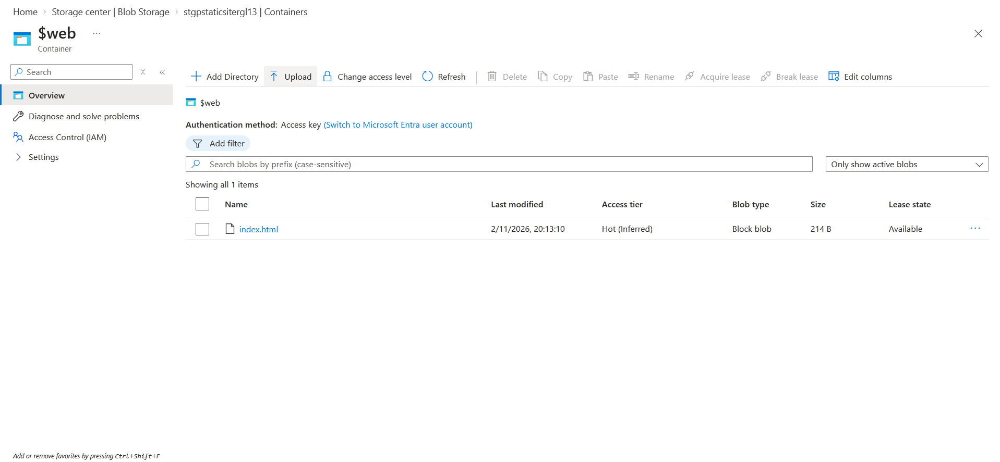
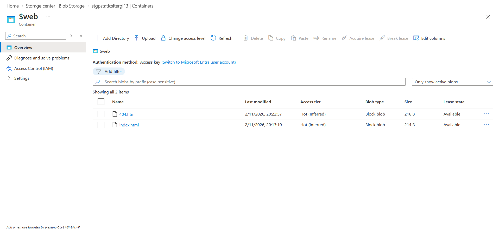
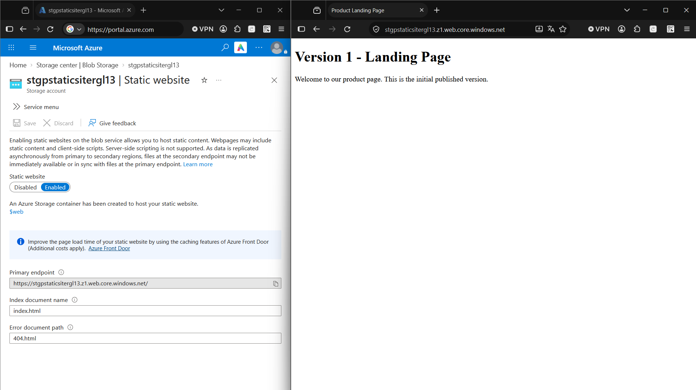
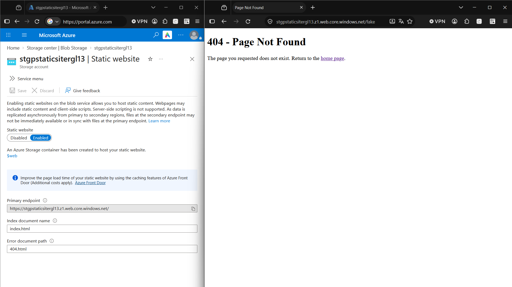

# Exercise 02: Upload and Verify Site Content

**Outcome:** a live public website displaying the Version 1 content, with a custom error page for missing paths.

| Item | Value |
|------|-------|
| Storage account | `stgpstaticsitergl13` |
| Container | `$web` |
| Files | `index.html`, `404.html` (source in [`../site/`](../site/)) |
| Endpoint | `https://stgpstaticsitergl13.z1.web.core.windows.net/` |

## Task 1: Create the HTML file locally

Created `index.html` in the repository's `site/` folder, so the same file can be reused by the Terraform version later. Created it with VS Code rather than Notepad, because Notepad can silently save `index.html.txt` when Windows hides file extensions.

The page contains the heading **Version 1 - Landing Page** and a welcome paragraph: [`site/index.html`](../site/index.html). Opened it locally in a browser before uploading, to separate "the file is wrong" from "the Azure configuration is wrong".

## Task 2: Upload the file to the `$web` container

1. Opened the storage account, then **Data storage → Containers → `$web`**.
2. Selected **Upload → Browse for files**, chose `index.html` and uploaded it.
3. Confirmed `index.html` appears in the container list.

The portal shows the blob as **Block blob**, 214 B, with access tier **Hot (Inferred)**. "Inferred" means no tier was set on the blob, so it inherits the account default, which is Hot.



## Task 3: Create and upload a custom error page

Created [`site/404.html`](../site/404.html) with a **404 - Page Not Found** heading and a link back to the home page (`href="/"`), then uploaded it to `$web` the same way. Both files now appear in the container.



**Verification from the CLI:**

```powershell
az storage blob list --account-name stgpstaticsitergl13 --container-name '$web' --auth-mode key --query "[].{name:name}" -o table
```

```text
Name
----------
404.html
index.html
```

## Task 4: Verify the live site and error page

1. Opened the **Primary endpoint** from the **Static website** page. The page shows **Version 1 - Landing Page** and the welcome message.
2. Appended `/fake` to the URL. The custom **404 - Page Not Found** page appears. (Any path that does not exist triggers it.)
3. Selected the **home page** link, which returns to the landing page.




**Verification from the command line:**

```powershell
curl.exe -I https://stgpstaticsitergl13.z1.web.core.windows.net/
```

```text
HTTP/1.1 200 OK
Content-Length: 214
Content-Type: text/html
```

`Content-Type: text/html` confirms Azure serves the page as HTML. For a missing path, a HEAD request (`curl.exe -I`) returns `HTTP/1.1 404` with `x-ms-error-code: WebContentNotFound` and no body. A GET request, which is what a browser sends, returns the custom page.

## Validation

- [x] `$web` contains both `index.html` and `404.html`
- [x] The landing page displays **Version 1 - Landing Page**
- [x] Browsing to a nonexistent path shows the custom **404 - Page Not Found** page
- [x] `index.html` is served with content type `text/html`

## Notes and issues

- `az storage blob list --auth-mode login` failed with a permissions error. Azure separates the **management plane** (creating resources, which the account could do) from the **data plane** (reading blob contents), which requires a data role such as *Storage Blob Data Contributor*. The portal worked because it used the account key. Workaround: `--auth-mode key`. A cleaner long-term fix is assigning the data role.
- In PowerShell, `$web` must be written in **single quotes** (`'$web'`). In double quotes PowerShell expands it as an empty variable.
- The CLI's table output omitted the content-type column, so the content type was confirmed from the HTTP response headers instead.