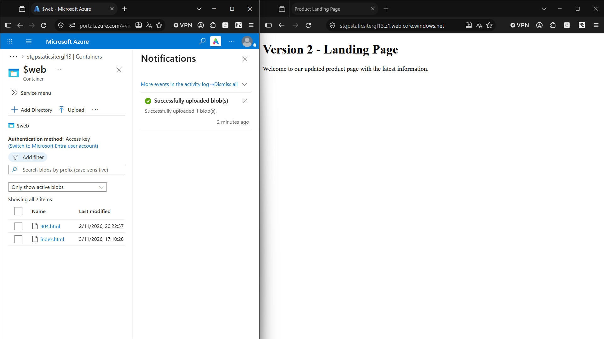
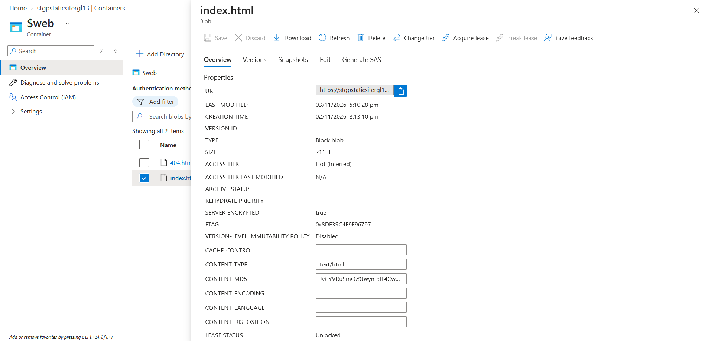
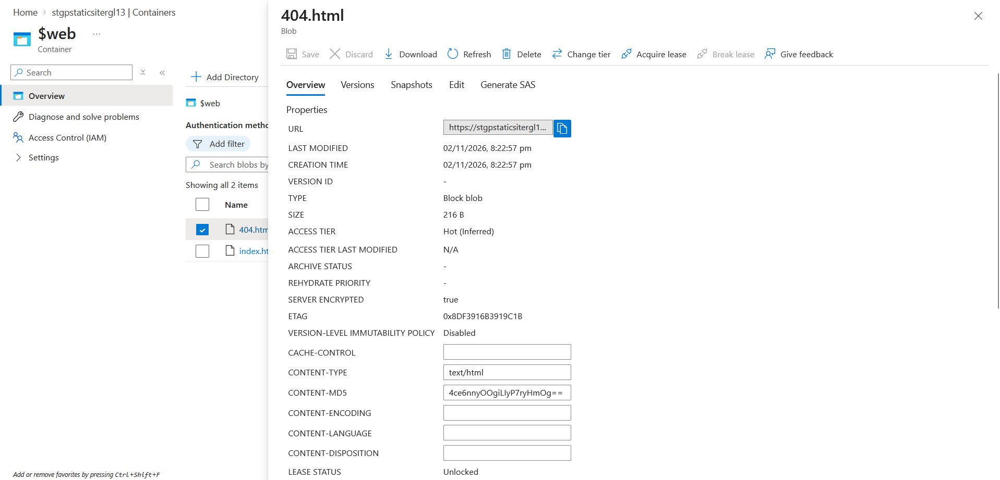

# Exercise 03: Update the Site Content

**Outcome:** the live website displays the Version 2 content after the original file is replaced.

| Item | Value |
|------|-------|
| Storage account | `stgpstaticsitergl13` |
| File updated | `index.html` (source in [`../site/`](../site/index.html)) |
| Endpoint | `https://stgpstaticsitergl13.z1.web.core.windows.net/` |

## Task 1: Create the updated HTML file

Edited `site/index.html` in place, so Git records the change as Version 1 becoming Version 2. The heading is now **Version 2 - Landing Page** and the paragraph describes the updated page. Checked it locally in a browser before uploading with `curl`.

## Task 2: Upload the updated file

1. Opened the `$web` container and selected **Upload → Browse for files**.
2. Selected the updated `index.html` and ticked **Overwrite if files already exist**. Without this option, Azure refuses to upload a file whose name already exists.
3. Selected **Upload**. The portal confirmed "Successfully uploaded 1 blob(s)".

## Task 3: Verify the updated site

Refreshed the live endpoint. It now shows **Version 2 - Landing Page** and the updated message.



Browsers cache pages, so if the old version appears after an upload, a hard refresh (Ctrl+F5) or a private window settles it.

## Task 4: Review blob properties and access tier

Opened the properties of both blobs from the container.

| Property | `index.html` | `404.html` |
|----------|--------------|------------|
| Content type | `text/html` | `text/html` |
| Access tier | Hot (Inferred) | Hot (Inferred) |
| Type | Block blob | Block blob |
| Size | 211 B | 216 B |

"Inferred" means no tier was set on the blob, so it inherits the account's default access tier (Hot). The overwrite is visible in the timestamps: `index.html` keeps its original **Creation time** (02/11/2026, 20:13) while **Last modified** moved to 03/11/2026, 17:10. It is the same blob with new content.





**Verification from the CLI:**

```powershell
az storage blob show --account-name stgpstaticsitergl13 --container-name '$web' --name index.html --auth-mode key --query "{name:name, contentType:properties.contentSettings.contentType, tier:properties.blobTier}" -o json
```

```json
{
  "contentType": "text/html",
  "name": "index.html",
  "tier": "Hot"
}
```

The same command for `404.html` returns `"contentType": "text/html"` and `"tier": "Hot"`.

## Validation

- [x] The live site shows **Version 2 - Landing Page**
- [x] Both blobs show content type `text/html`
- [x] Both blobs show access tier `Hot`

## Tracking changes: lessons learned

Overwriting a blob replaces it, and Azure keeps no history by default (the **Versions** tab is empty and **Version ID** is `-`). Ways to keep history and recover from a bad upload:

- **Git** holds every version of `site/index.html`. A rollback means restoring the file from Git and uploading it again.
- **Blob versioning** and **soft delete** (storage account → Data protection) keep earlier versions and deleted blobs inside Azure.
- **Automated deployment** (for example GitHub Actions) uploads from `main`, so the live site always matches the repository. Not part of this guided project.

## Notes and issues

- The `--auth-mode login` data-plane error from Exercise 02 applies to `az storage blob show` too. `--auth-mode key` is used as a workaround.
- The CLI's `az storage blob show` reports the tier as `Hot`, while the portal labels it `Hot (Inferred)`. Both refer to the account default.